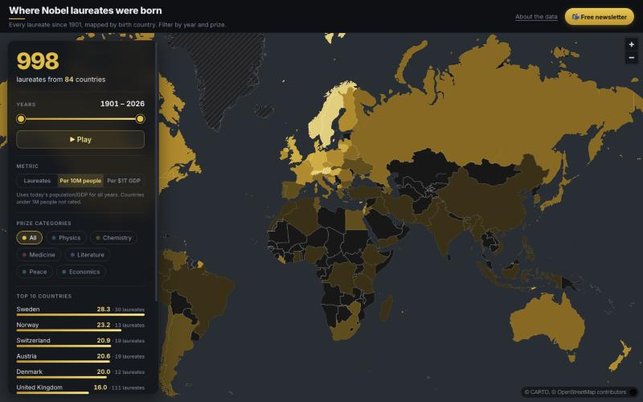

# Where Nobel laureates were born

An interactive, dark-themed map of every Nobel laureate since 1901, by birth country (modern borders).
Filter by year range and prize category, press Play to watch the map fill in, hover for a per-category
breakdown, click a country for its laureates. The view is kept in the URL hash, so it can be shared:
`#from=1901&to=2025&cat=Physics,Chemistry`.



## Run locally

```bash
python3 -m http.server 8000
# open http://localhost:8000
# open http://localhost:8000/?mock=1 to use the small test data in data/mock/
```

No build step, no dependencies to install (MapLibre GL JS 4.7.1 loads from unpkg, the font from Google Fonts).

## Deploy (GitHub Pages)

Push to GitHub, then Settings > Pages > Source: "Deploy from a branch", branch `main`, folder `/ (root)`.
The empty `.nojekyll` file stops Jekyll from processing the site.

## Data sources and licences

- Nobel Prize API v2 (api.nobelprize.org), CC0
- Natural Earth admin-0 countries 1:50m, public domain
- Base map: CARTO Dark Matter (no labels), (c) OpenStreetMap contributors (c) CARTO

Counting rule: distinct laureates per birth country, so Marie Curie counts once for Poland.
Organizations and laureates with no birth country are excluded.


## Layout

```
index.html        page shell
src/app.js        config (URLs, palette, newsletter) at the top, then state, map and UI logic
src/style.css     styles
data/             laureates.json + countries.geojson (generated from the Nobel Prize API v2 and Natural Earth)
```
